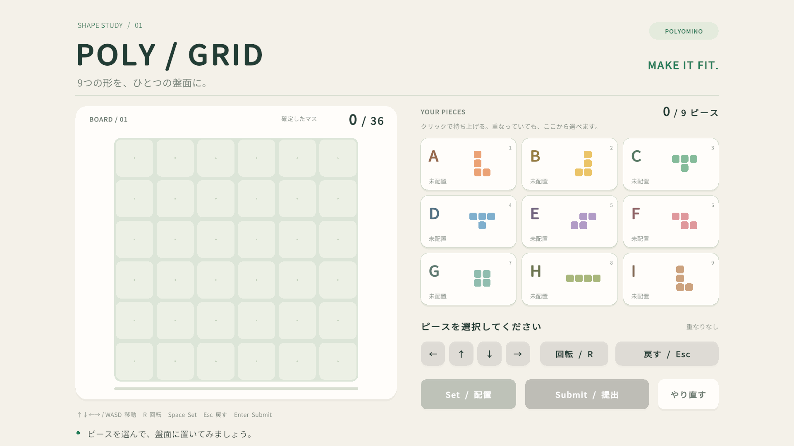

# POLY / GRID

「人はゲームをどこまで宣言的に設計できるか」を検証するUnityパズルのサンプルです。

6×6の盤面を9個のテトロミノで埋めます。重なった配置を仮置きでき、完成後に提出するとピースがAからIの順に光ります。



## 起動

1. **Unity 6000.6.4f1**でこのフォルダを開きます。
2. `Assets/Puzzle/Scenes/PolyGrid.unity`を開き、Playを押します。

シーンとマスターは作成済みです。シーンがない場合は `Tools > Declarative Puzzle > Create Sample Scene` で作成できます。このメニューは既存シーンやマスターを上書きしません。

盤面サイズは `Assets/Puzzle/MasterData/SamplePuzzle.asset`、形状と色は同フォルダの各ピースで編集できます。セル座標は左下原点です。Play開始時にマスターから盤面・ピースの表示を組み直すため、シーンのセルを手で増減する必要はありません。形状は連結した重複のないセル集合、全ピースの面積は盤面の面積と一致させます。ピース数は可変で、数字キーの選択は最初の9個に対応します。

## 操作

| 操作 | マウス / キーボード |
|---|---|
| ピースを持ち上げる | 盤面または右のピース一覧をクリック / `1`〜`9` |
| 1マス移動 | 矢印ボタン / `↑↓←→` / `WASD` |
| 時計回りに90度回転 | 回転ボタン / `R` |
| 配置を確定 | Set / `Space` / 持ち上げ中の`Enter` |
| 持ちピースに戻す | 戻す / `Esc` / `Backspace` |
| 完成した配置を提出 | Submit / 持ち上げていないときの`Enter` |
| 最初から遊ぶ | やり直す |

持ち上げ中は、元の所属・配置が確定状態に残ります。表示はHoldingを優先するため、同じピースが二重に描かれることはありません。Setで配置を更新し、戻す操作で持ちピースへ戻します。移動は盤面内に制限され、回転時は必要に応じて原点を補正します。

重なりは仮置きとして許可します。完成条件は全ピースの配置、盤面全セルの充填、重なり・盤面外セルの不存在です。持ち上げ中や送信・演出中は提出できません。指定された絵柄や正解座標はなく、条件を満たす配置ならどれも正解です。

## 実装の入り口

| ファイル / フォルダ | 責務 |
|---|---|
| `Assets/Puzzle/Domain/` | Immutableなrecord、値として比較できる防御的コピーのコレクション、純粋なGameRules |
| `Assets/Puzzle/Application/` | 正規状態を更新するUseCaseとRepository・提出のポート |
| `Assets/Puzzle/Presentation/` | ViewStateの純粋な射影、R3入力イベントを扱うPresenter |
| `Assets/Puzzle/Unity/` | View、Composition Root、ScriptableObject、インメモリRepository、DOTween・入力・音 |
| `Assets/Puzzle/MasterData/` | 盤面と9個のピースのマスター |
| `Assets/Puzzle/Tests/EditMode/` | ルール、UseCase、非同期提出、Presenter、サンプル解の検証 |
| `Assets/Puzzle/Tests/PlayMode/` | 実際のボタン入力、描画、提出演出、マスター変更の結合テスト |
| `Assets/Puzzle/Editor/SampleProjectBuilder.cs` | Unity APIでマスター・フォント・シーンを生成するEditor用ツール |

設計上の判断と仕様変更の観察点は [docs/architecture.md](docs/architecture.md)、動作確認用の解は [docs/sample-solution.md](docs/sample-solution.md) を参照してください。

## テスト

Unityの `Window > General > Test Runner` からEditMode / PlayModeの両方を実行できます。**EditMode 31件、PlayMode 5件が成功**しています。検証内容は [docs/verification.md](docs/verification.md) を参照してください。

Unity CLIとPipelineが接続された実行中のEditorからは次を使えます。完了状態は `unity command test_status --caller plugin --skill unity-cli --format json` で確認します。

```sh
unity command run_tests --caller plugin --skill unity-cli --mode editor --filter DeclarativePuzzle.Tests --filter_type assembly --async_tests true --format json
unity command run_tests --caller plugin --skill unity-cli --mode playmode --filter DeclarativePuzzle.PlayModeTests --filter_type assembly --async_tests true --format json
```

片方のテストが完了してから次を実行してください。

## 依存関係

R3はイベント購読に使い、ReactivePropertyによる状態管理は使いません。DOTweenは移動の補間、Squash & Stretch、Punch、ボタンの反応、順次発光、紙吹雪を担当します。効果音は短い波形を実行時に生成します。日本語フォントはNoto Sans CJK JPです。

R3のNuGet本体と依存DLL、DOTween Free、日本語フォントは同梱しています。R3.UnityなどのUPMパッケージはUnityが復元します。配布元・バージョン・ライセンスは [THIRD_PARTY.md](THIRD_PARTY.md) に記載しています。

初期実装の提出先はローカルです。`ISubmissionGateway`をHTTPアダプターに差し替えることで通信を追加できます。保存・サーバー・課金は導入していません。
