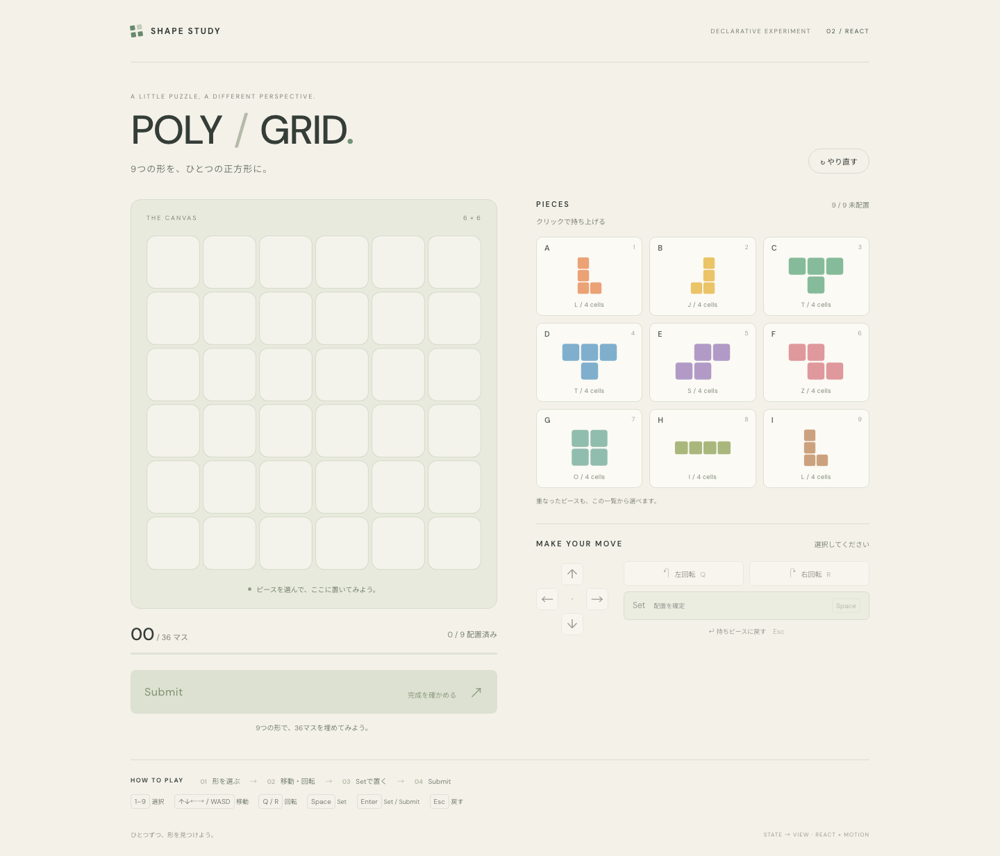
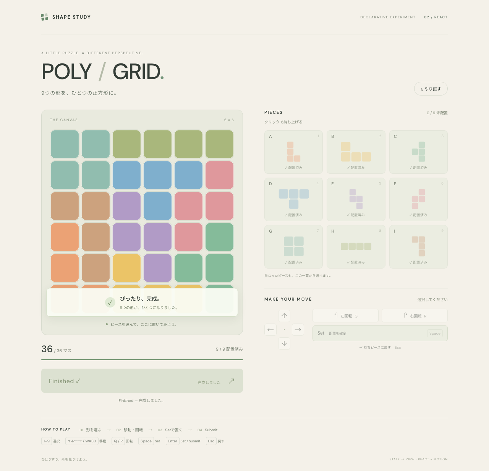

# POLY / GRID — React

「人はゲームをどこまで宣言的に設計できるか」を検証するReact版です。Unity版と同じ6×6の盤面を、同じ形状・色の9個のテトロミノで埋めます。

React + TypeScript + Vite、Motion for React、CSS / SVG、Vitestを使用します。ゲームの正規状態は`useReducer`で管理し、バックエンドや追加の状態管理ライブラリは使いません。



## 起動

Node.js 20.19+（20系）、22.12+（22系）、または24以降を使用してください。

macOSでは、Finderでこのフォルダの **`Start.command`をダブルクリック**すると、開発サーバーが起動してブラウザにゲームが開きます。初回は依存パッケージを自動でインストールします。起動済みの場合はそのサーバーを使ってブラウザだけ開きます。遊んでいる間はTerminalを開いたままにし、終了するときはそのTerminalで`Control+C`を押してください。

ターミナルから手動で起動する場合は次を使います。

```sh
cd React
npm ci
npm run dev
```

表示されたローカルURLをブラウザで開きます。ビルドは`npm run build`、ビルド結果の確認は`npm run preview`です。ゲーム処理と提出判定はブラウザ内で完結します。Google Fontsへのアクセスができない場合はシステムフォントで表示します。

## 操作

| 操作 | マウス・タッチ | キーボード |
|---|---|---|
| 持ち上げる | 盤面のピース、またはピース一覧を選択 | `1`〜`9` |
| 1マス移動 | 矢印ボタン | `↑↓←→` / `WASD` |
| 左に90度回転 | 左回転 | `Q` |
| 右に90度回転 | 右回転 | `R` / `E` |
| 配置を確定 | Set | `Space` / 持ち上げ中の`Enter` |
| 持ちピースに戻す | 戻す | `Esc` / `Backspace` |
| 完成した配置を提出 | Submit | 持ち上げていないときの`Enter` |
| 最初から遊ぶ | やり直す | Tabでボタンを選択して実行 |

Tabでボタンに移動した場合は、Enter・Spaceをそのボタンの標準操作として扱います。マウスで選択した後は、そのままゲームのキーボード操作を続けられます。

持ち上げられるピースは1個だけです。移動・回転は盤面内に補正します。重なりを含む仮置きは可能で、重複セルには赤いマーカーが表示されます。重なったピースも一覧から選択できます。

追加実験では、左右の回転を1回0.2秒で入力順に再生します。回転中の入力も列に追加するため、高速な右→左も両方表示されます。回転の再生中は移動・Set・Returnが無効になり、回転とRestartは引き続き操作できます。Restartは現在の回転と未再生の列を破棄します。

全9個を配置し、36セルを重複・不足なく埋め、持ち上げていない場合にSubmitが有効になります。提出は650ms待つローカルのPromise処理です。成功するとA〜Iが順に発光し、最後の発光終了後にFinishedになります。失敗時は配置を維持して再提出できます。やり直すと処理・演出を中断して新しいゲームを始めます。

動作確認用の解は[Unity版のサンプル解](../Unity/docs/sample-solution.md)と共通です。

## 実装

| ファイル | 責務 |
|---|---|
| `src/game/types.ts` | GameState、Action、パズル定義 |
| `src/game/puzzleData.ts` | Unityマスターと同じ盤面・形状・色 |
| `src/game/rules.ts` | 回転、補正、占有状況、完成判定、提出可否 |
| `src/game/reducer.ts` | 純粋な状態遷移、初期状態 |
| `src/game/selectors.ts` | Holdingを優先した表示と重複の射影 |
| `src/components/` | 盤面、ピース一覧、操作、非同期結果のdispatch |
| `src/animations/celebration.ts` | 発光Variants、発光時間・間隔 |
| `src/animations/rotationPlayback.ts` | 回転列、開始・終了姿勢、完了通知を扱う表示用Reducer |
| `src/services/submitPuzzle.ts` | PromiseとAbortSignalを使う疑似提出API |

設計上の判断と比較は[設計の観察](docs/architecture.md)を参照してください。

## ベースラインと追加実験

初期React版はGitタグ **`react-baseline`**（`49805e3`）に保存しています。追加実験は`experiment/react-rotation-queue`ブランチです。比較する場合は、別の作業ディレクトリでベースラインを起動できます。

```sh
git worktree add --detach ../declarative01-react-baseline react-baseline
cd ../declarative01-react-baseline/React
npm ci
npm run dev -- --port 5174
```

回転列の状態・責務、累積回転数で失われる情報、宣言的APIを選んだ理由、変更規模は[回転列の実験](docs/rotation-queue.md)にまとめています。

## 検証

```sh
npm test
npm run build
npx playwright install chromium
npm run test:e2e
```

Vitest **50件**、Playwright **15件**、TypeScript検査と本番ビルドが成功しています。VitestではUnityのマスターとの一致、負の回転・累積回転、端での位置補正、完成・重複・盤面外判定、全フェーズの入力制限、失敗復帰、提出の中断を検証します。追加した10件は回転列の保存、再生中の追加、完了IDの照合、境界補正、操作の待機を検証します。マスターとの一致テストは隣の`Unity/`を読み取ります。

Playwrightでは盤面・一覧の選択、マウスからキーボードへの切替、実際のセル描画位置、Unityの解の再現、A〜Iの発光順、送信失敗・受付拒否からの再提出、多重送信防止、やり直し時のキャンセル、Tab操作、375px幅のタッチ操作とReduced Motion設定でのFinished到達を検証します。対象ブラウザはChromiumです。

追加した7件は同一Reactバッチ内の右→左、再生中の入力追加、0.2秒の再生時間、複数周の混合入力、壁際の最終位置、Restartの中断、Set後の再選択を実際のDOM角度で検証します。実行時のスクリーンショットは`test-results/`に出力し、保存済みのベースライン画像を上書きしません。


