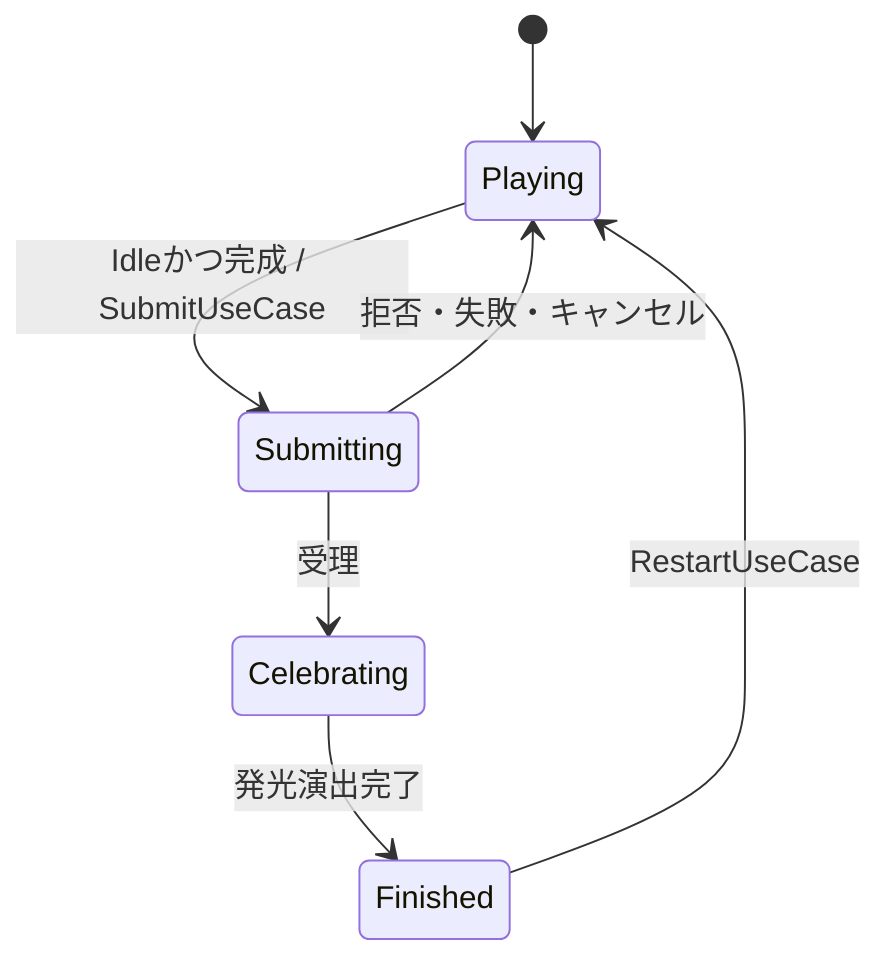

# 設計方針と実装上の判断

## 目的

テーマは「人はゲームをどこまで宣言的に設計できるか」。状態空間と表示仕様を値として宣言し、状態から表示を導出する。ただし、宣言性そのものを目的化せず、仕様変更に応じて手続的な記述を採用する。

## 状態モデル

`GameState`は`PuzzleDefinition`、`PuzzleState`、`InteractionState`、`SubmissionPhase`を持つImmutableな集約ルート。

```text
PieceLocation  = InStock(id) | Placed(id, origin, rotation)
Interaction   = Idle | Holding(id, origin, rotation)
Submission    = Playing | Submitting | Celebrating | Finished
```

Holdingはゲームの論理状態であり、入力・表示だけの可変状態にはしない。Holdingへの移行や移動・回転で`PuzzleState`を変更せず、Set時に配置を置き換える。ReturnToStockは元配置を消し、所属を持ちピースに確定する。

`ValueList<T>`は入力列をコピーし、可変の配列を公開しない。各要素もImmutableにし、recordの等価比較では要素の値を比較する。ScriptableObjectの可変データは初期化時に検証・コピーしてDomainへ渡す。DomainとApplicationはUnityEngineを参照しない。

ピース形状は隣接するセル集合。座標は左下原点、xが右、yが上。回転は時計回りの90度単位。回転後のセル集合を左下のバウンディングボックスへ正規化するため、配置原点の意味が一定になる。壁際の回転では必要最小限の座標補正を行い、向きそのものが盤面に収まらない場合は回転を拒否する。

## ルールと正規状態の更新

`GameRules`はstaticな純粋関数。PickUp / Move / Spin / Set / ReturnToStockは新しい状態を返し、不正・許可されない操作は元の状態を返す。Repositoryへの参照、乱数、時刻、Unityオブジェクトを持たない。

`StateUseCase`は現在状態を読み、ルールを適用し、変化したときだけ保存する。Presenterには読み取り用`IGameStateReader`とUseCase群を渡す。ViewからRepositoryを操作する経路は設けない。Repositoryの初期状態の作成はComposition Rootで行い、それ以降のSave呼び出しはApplicationのUseCaseに集める。

`Analyze`は確定済み配置を判定する。全ピースが置かれ、全セルが一度ずつ覆われ、盤面外セルがなければ完成。`Preview`はHoldingの候補を計算し、そのピース自身の元配置を重なり判定から除外する。重なりがあってもSetできる。

## 表示と入力

通常操作のデータフロー:

```text
Unity Input → R3 → Presenter → UseCase → GameRules → Repository
  → GameState読み取り → ViewStateProjection → Render
```

`PieceViewState`はInStock / Held / PlacedのADT。射影はHoldingを優先し、確定状態に元配置が残っていても二重表示しない。提出可否、操作可否、ボタンの活性、数値、メッセージ、重なりプレビューは、その時点の状態から導出する。

`PuzzleView.Render(PuzzleViewState)`と`PieceView.Render(PieceRenderState)`は操作履歴に依存せず、値から可視性・姿勢・UIを更新する。R3はボタンや入力のイベント配送と購読解除に使う。ReactivePropertyや状態の自動購読には使わない。更新タイミングはPresenterが明示する。

View内の直前表示値やTween参照は、重複描画の削減と現在の見た目から目標姿勢への補間にだけ使う。これらは完成条件や次の状態の計算に影響しない。

マスターの盤面サイズ、ピース数、セル数を変えた場合は、`PuzzleSceneLayout.RefreshMaster`が初期化時にグリッドとピース表示を組み直す。盤面を492×492の領域に収め、縦横の比率を保ってセルサイズを算出する。見出し・操作ボタンの構造は保存済みシーンに置き、マスター由来の表示要素は起動時に生成する。プレイ中の操作では構造を作り直さず、Renderで表示を更新する。

## 非同期提出



提出の進行はボタンの可変フラグではなく、`GameState.Phase`で宣言する。`SubmitUseCase`は最初のawaitより前にSubmittingを保存し、同じフレームの二重送信も阻止する。UseCase・GameRulesの双方でSubmitting / Celebrating / Finished中の盤面操作を拒否する。

ゲートウェイにはImmutableな提出スナップショットとCancellationTokenを渡す。拒否・例外・キャンセル時は元状態に復帰し、再提出可能にする。受理後はCelebratingへ移行し、PresenterがRenderと命令的な`PlayCelebrationAsync`を調停する。順次発光完了後、`FinishCelebrationUseCase`がFinishedを保存する。

シーン停止・非活性化時はPresenterが購読を解除してキャンセルする。Viewは自分のTweenと紙吹雪を止める。破棄済みViewへのRenderは行わない。このサンプルはオンメモリで、シーン再開時は初期状態から開始する。

## 時系列の演出

移動のEase、持ち上げ・配置時のPunch / Squash & Stretch、壁際の揺れ、音、順次発光、紙吹雪、ボタンの拡縮は命令的に記述する。

`Render`だけで発光の時間軸を表現しようとせず、`GlowAsync`と`PlayCelebrationAsync`を公開する。GameRulesへアニメーションの経過時間を入れない。DOTweenのキャンセルはUnityのSynchronizationContextへ戻し、Unityオブジェクトをメインスレッドで扱う。

## 責務と抽象化の範囲

MVP / Clean Architecture / 関数型の思想を参考にするが、形式的な遵守はしない。UseCaseは状態更新の入口と非同期処理の整合性を担い、Presentationは入力と表示を調停する。Repositoryは現在の正規状態を一か所で保持する。依存方向はasmdefで区切る。

単一画面、メモリ内Repository、ローカル提出ゲートウェイを初期範囲とする。永続化、HTTP、DIフレームワーク、Event Sourcing、リアクティブな状態管理は必要になった時点で検討する。

## 仕様変更で観察すること

| 変更例 | 観察点 |
|---|---|
| 盤面サイズ、ピース形状の変更 | マスターとDomain検証だけで対応できるか。UIのセルサイズ計算は成立するか |
| 重なり禁止、配置取り消しの追加 | 純粋ルールとInteractionの表現で閉じるか |
| ドラッグ・連続移動の追加 | Modelに入れる状態と、入力デバイスに閉じる一時状態の境界 |
| SubmitのHTTP化、再試行 | GatewayとUseCaseが有益な抽象化として働くか |
| 一部ピースだけの成功演出、複数の演出順 | 宣言的な演出データにする価値と、命令的なSequenceの分かりやすさ |
|Undo / Redo、途中保存 | Immutableスナップショットをどの範囲で保管するか |

最終目標は完全に宣言的なゲームではなく、宣言的な設計が有効な範囲と限界を実装から明らかにすること。

## 追加実験：回転の入力履歴

左右回転と回転中の追加入力に対応した。GameStateとViewStateの状態空間は維持し、入力時に正規状態を更新する。Presenterは成功した回転について、方向と到達先のImmutableな表示値を`QueueRotation`へ渡してから、最新状態をRenderする。

`RotationPlayback`は画面全体のFIFOを持ち、1回0.2秒のDOTween完了時に次の回転を始める。PieceViewは最新Renderの値を目標として保持し、予約済みの回転がある間は姿勢の上書きを待つ。各回転の完了時にセル集合を正規化して描き直し、最後に最新Renderの位置・回転へ一致させる。

したがって、Renderは最終的に満たす表示仕様を表す。途中の回転順序は命令的な演出キューが表す。4回転して同じGameStateへ戻った入力でも、4回の演出を失わない。詳しい変更規模と考察は [回転キューの実験レポート](rotation-queue-experiment.md) を参照。
