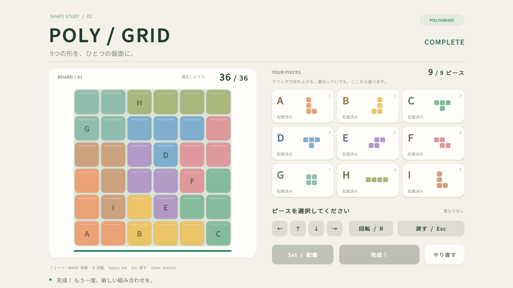

# 動作確認用の解

座標は盤面の左下を(0,0)とし、回転後の形の左下バウンディングボックスを配置原点とします。各ピースを持ち上げ、Rで指定回数回転し、矢印またはWASDで移動してSetしてください。

| ピース | 原点 (x, y) | 時計回りの回転 |
|---|---|---|
| A | (0, 0) | 0° |
| B | (2, 0) | 90° |
| C | (4, 0) | 90° |
| D | (2, 3) | 0° |
| E | (2, 1) | 90° |
| F | (4, 2) | 90° |
| G | (0, 4) | 0° |
| H | (2, 5) | 0° |
| I | (0, 1) | 180° |

完成した盤面（上からy=5〜0）:

```text
G G H H H H
G G D D D F
I I E D F F
A I E E F C
A I B E C C
A A B B B C
```

これは一例です。全ピースが盤面内に収まり、全36セルが一度ずつ埋まる配置は、いずれも提出できます。


